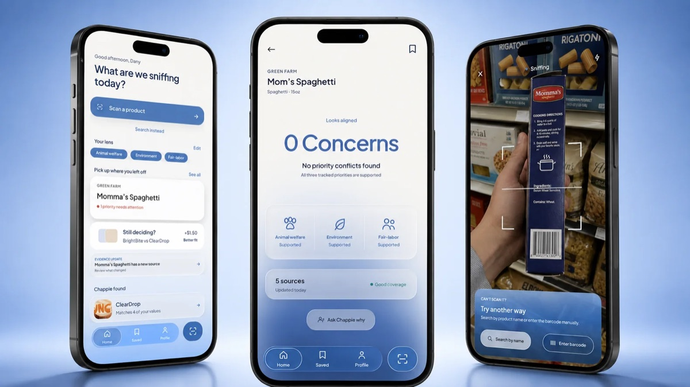
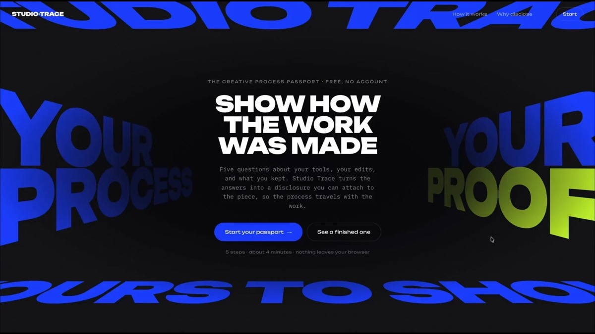
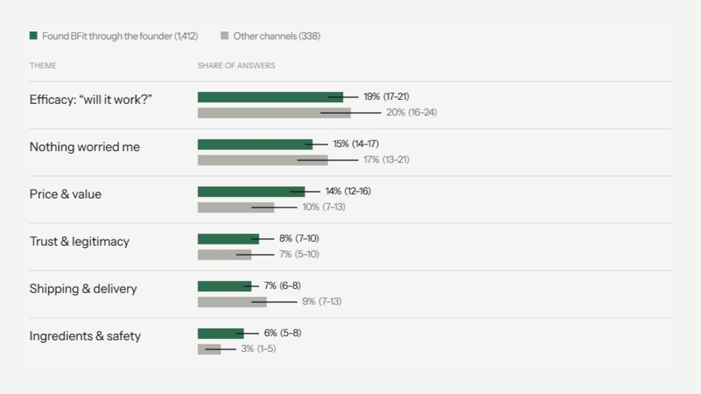
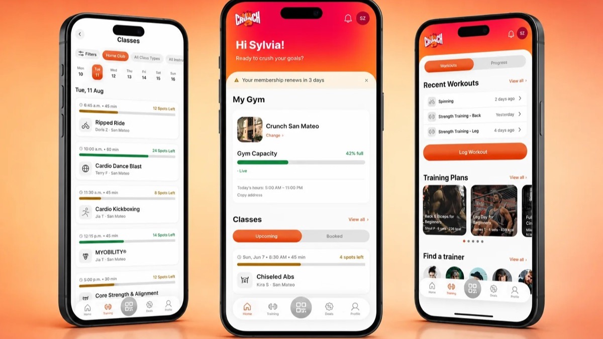

<a href="https://sylviazamora.com/">
  <picture>
    <source media="(prefers-color-scheme: dark)" srcset="assets/logo-dark.png">
    
  </picture>
</a>

Product designer in San Francisco, studying for an MA in Interaction & UX/UI at Academy of Art University. I started in research and data: two years at Unmade, an e-commerce consultancy, turning customer feedback from 20+ brands into store changes, including a product-page redesign projected at MX$1M+ in additional yearly revenue. Promoted to UX Researcher three months in.

[Portfolio](https://sylviazamora.com/) · [LinkedIn](https://www.linkedin.com/in/sylvia-zamora-trevino/) · [Medium](https://medium.com/@sylviazamorat) · sylviazamorat@gmail.com

### Selected work

<table>
  <tr>
    <td width="50%" valign="top">
      
       <strong><a href="https://sylviazamora.com/work/chappie/">Chappie</a></strong>
       An ethical shopping app that shows its evidence instead of a single score. Survey, interviews and a usability test with 8 shoppers.
    </td>
    <td width="50%" valign="top">
      
       <strong><a href="https://studio-trace.netlify.app/">Studio Trace</a></strong> · <a href="https://github.com/SylviaZam/studio-trace">code</a>
       A live web app that records how AI took part in creative work, so the creator's own judgment stays visible.
    </td>
  </tr>
  <tr>
    <td width="50%" valign="top">
      
       <strong><a href="https://sylviazamora.com/work/bfit/">BFit: same doubts, different reasons</a></strong>
       Research for a Mexican wellness brand at Unmade. 3,554 survey responses showed every kind of buyer shared one doubt: will it work?
    </td>
    <td width="50%" valign="top">
      
       <strong><a href="https://sylviazamora.com/work/crunch/">Crunch Fitness</a></strong>
       A concept redesign of the gym app that puts check-in and workout logging ahead of offers.
    </td>
  </tr>
</table>

### Code

- [Automated Review Analysis Pipeline](https://github.com/SylviaZam/Automated-Review-Analysis-Pipeline): codes Spanish-language survey and review exports into themes. It packages the feedback workflow I ran at Unmade.
- [A/B Experimentation Playbook](https://github.com/SylviaZam/AB-Experimentation-GTM-Playbook), [Cohort CAC/LTV Model](https://github.com/SylviaZam/GTM-Cohort-CAC-LTV) and [Retail Trend Radar](https://github.com/SylviaZam/Retail-Trend-Activation-Radar): Python and SQL analyses that end in an Excel readout.

### Play

[Type Is Feeling](https://type-is-feeling.sylviazamorat.workers.dev/), a type specimen that changes with mood, and [Please Do Not Touch](https://please-do-not-touch-gallery.netlify.app), a gallery sculpture you are not supposed to poke.

### Writing

[AI Can Generate the UI. Who Designs the Rules?](https://medium.com/design-systems-collective/ai-can-generate-the-ui-who-designs-the-rules-1c4d5b18a7c1) · [The Devaluation of "Discovery"](https://medium.com/@sylviazamorat/the-devaluation-of-discovery-4749d83722a8) · [Your Design System Speaks English](https://www.designsystemscollective.com/your-design-system-speaks-english-c1b5e89e03dc)

Figma · Adobe Creative Cloud · HTML, CSS, JavaScript · Python · SQL · Claude Code · Codex

Berry fact: zarzamora means blackberry.
